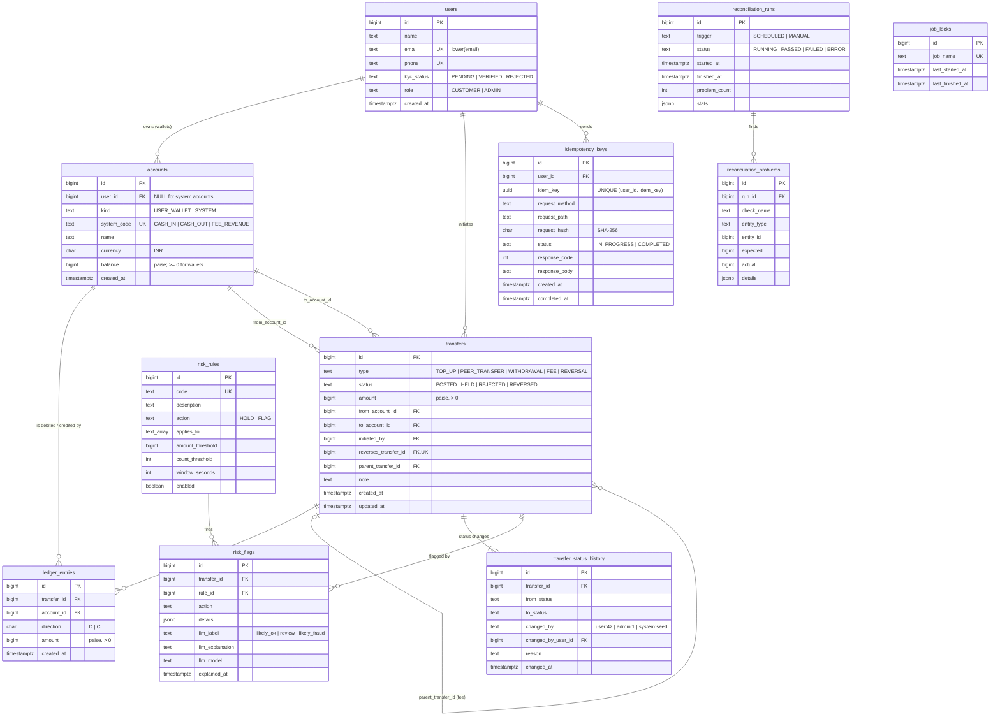

# Schema design

The migrations in `src/main/resources/db/migration` build everything below from an empty database:

| File | Contents |
|---|---|
| `V1__core_schema.sql` | tables, keys, check constraints, indexes |
| `V2__ledger_guards.sql` | triggers: append-only ledger, balanced-transfer assertion, status-transition rules, audit log |
| `V3__reference_data.sql` | system accounts, the admin user, the job lock row, fraud rules |
| `db/devtools/R__seed_demo.sql` | `seed_demo()` data generator (separate Flyway location; not business schema) |

## 1. Finding the tables: every noun in the requirements

A noun becomes a table when we need to store facts about it that live longer than one request.

| # | Noun | Table? | Why |
|---|---|---|---|
| 1 | platform | no | There is only one; it's the system itself. |
| 2 | **user** | `users` | We store name, email, phone and KYC status for each one, and many other rows point at users. |
| 3 | name, email, phone, KYC status | no (columns) | Single-valued facts about a user. KYC is a small fixed set, so it's a `CHECK`ed column, not a lookup table. |
| 4 | **wallet** | `accounts` | Many per user; has a currency and a balance; money moves in and out of it. |
| 5 | currency | no (column) | INR only. A `CHECK (currency = 'INR')` column keeps the door open without a table nobody needs yet. |
| 6 | **system account** (cash-in, cash-out, fee revenue) | `accounts` | Same behaviour as a wallet from the ledger's point of view: entries debit and credit it. Stored in the same table, with `kind = 'SYSTEM'` (see README, design question 2). |
| 7 | **transfer** | `transfers` | The business event: type, status, amount, created time, plus links (reversal → original, fee → withdrawal). |
| 8 | transfer type / status | no (columns) | Fixed enumerations; `CHECK` constraints. Status *transitions* are enforced by a trigger. |
| 9 | **ledger entry** | `ledger_entries` | The debit/credit lines; two or more per transfer. The source of truth for money. |
| 10 | debit / credit | no (column) | `direction CHAR(1)` with `CHECK IN ('D','C')`. |
| 11 | reversal | no (it's a transfer) | A reversal *is* a transfer of type `REVERSAL` with `reverses_transfer_id` pointing at the original. |
| 12 | balance | no (column) | Cached on `accounts.balance`, always derivable from entries (see README, design question 1). |
| 13 | **idempotency key** | `idempotency_keys` | Must outlive the request: key, owner, request hash, status, saved response. |
| 14 | statement | no | A query over `ledger_entries` for one account, not stored data. |
| 15 | **nightly check / reconciliation run** | `reconciliation_runs` | One row per run: start, end, status, counts. |
| 16 | **mismatch** | `reconciliation_problems` | One row per problem found: check, entity, expected, actual. |
| 17 | **job lock** | `job_locks` | One row per job, locked with `FOR UPDATE NOWAIT` so only one run executes at a time. |
| 18 | **fraud rule** | `risk_rules` | Thresholds must be data, not code: code, action (HOLD/FLAG), thresholds, enabled. |
| 19 | **flag** | `risk_flags` | Which rule fired on which transfer, with what evidence, plus the LLM's explanation and label. |
| 20 | review / admin | no (role column) | An admin is a user with `role = 'ADMIN'`; a review decision is a status change, recorded in the audit log. |
| 21 | question (plain-English) | no | Answered on the fly. Responses are kept only through `idempotency_keys`. |
| 22 | **audit log entry** | `transfer_status_history` | Who changed which transfer's status, from what, to what, when, and why. |

## 2. Attributes and keys

Every table has `id BIGINT GENERATED ALWAYS AS IDENTITY PRIMARY KEY`. Table names are plural snake_case;
column names are singular. Money columns are `BIGINT` paise. Timestamps are `TIMESTAMPTZ`.

Natural keys that come from outside (email, phone, the client's idempotency key) are `UNIQUE`, never
primary keys: people change phone numbers and email addresses, and foreign keys should not have to follow.

## 3. Cardinality

| Pair | From the left | From the right | Result | Foreign key |
|---|---|---|---|---|
| users – accounts | a user has 0..N wallets | a wallet belongs to exactly 1 user; a system account to none | 1:M (optional on the account side for system accounts) | `accounts.user_id` (nullable; `ck_accounts_owner` makes it required for wallets, forbidden for system accounts) |
| transfers – ledger_entries | a transfer has 2..N entries (0 while HELD/REJECTED) | an entry belongs to exactly 1 transfer | 1:M | `ledger_entries.transfer_id` |
| accounts – ledger_entries | an account has 0..N entries | an entry is on exactly 1 account | 1:M | `ledger_entries.account_id` |
| accounts – transfers (from) | an account sends 0..N transfers | a transfer has exactly 1 source | 1:M | `transfers.from_account_id` |
| accounts – transfers (to) | an account receives 0..N transfers | a transfer has exactly 1 destination | 1:M | `transfers.to_account_id` |
| transfers – transfers (reversal) | a transfer is reversed by 0..1 reversal | a reversal reverses exactly 1 transfer | 1:1 | `transfers.reverses_transfer_id UNIQUE` |
| transfers – transfers (fee) | a withdrawal has 0..N child fee transfers | a fee has exactly 1 parent | 1:M | `transfers.parent_transfer_id` |
| users – transfers (initiator) | a user initiates 0..N transfers | a transfer is initiated by 0..1 user (seeded data has none) | 1:M | `transfers.initiated_by` |
| transfers – transfer_status_history | a transfer has 1..N status rows | a row is about exactly 1 transfer | 1:M | `transfer_status_history.transfer_id` |
| users – idempotency_keys | a user has 0..N keys | a key belongs to 0..1 user (sign-up is anonymous) | 1:M | `idempotency_keys.user_id`, `UNIQUE NULLS NOT DISTINCT (user_id, idem_key)` |
| transfers – risk_rules (via risk_flags) | a transfer trips 0..N rules | a rule fires on 0..N transfers | **M:N** | mapping table `risk_flags (transfer_id, rule_id)`, unique per pair |
| reconciliation_runs – reconciliation_problems | a run finds 0..N problems | a problem belongs to exactly 1 run | 1:M | `reconciliation_problems.run_id` |

`transfers` has two foreign keys to `accounts` instead of a mapping table because every transfer in this
design is two-legged (fees are separate transfers). The *entries* are the general n-leg structure: the
schema and the balance trigger accept any number of legs as long as debits = credits = amount.

## 4. ER diagram

## 5. What the database enforces by itself

| Rule | Mechanism |
|---|---|
| Entry amounts are positive; direction stored separately | `CHECK (amount > 0)`, `CHECK (direction IN ('D','C'))` |
| A user wallet never goes negative; system accounts may | `ck_accounts_wallet_non_negative CHECK (kind = 'SYSTEM' OR balance >= 0)` |
| Wallets have an owner, system accounts don't | `ck_accounts_owner` |
| Ledger entries are insert-only | `trg_ledger_entries_immutable` (UPDATE/DELETE) and `trg_ledger_entries_no_truncate` |
| Every transfer's entries balance: debits = credits = amount, only on POSTED transfers | `trg_ledger_entries_balanced`, a statement-level trigger with a transition table |
| Only a transfer's status can change, and only HELD→POSTED, HELD→REJECTED, POSTED→REVERSED | `trg_transfers_guard_update`; `trg_transfers_no_delete` |
| Every status change is audited with an actor | `trg_transfers_audit_status`: refuses the write if `wallet.actor` isn't set in the transaction |
| A transfer is reversed at most once | `reverses_transfer_id UNIQUE` |
| Idempotency key unique per user (and per anonymous caller) | `UNIQUE NULLS NOT DISTINCT (user_id, idem_key)` |
| Email and phone are unique | `uq_users_email (lower(email))`, `uq_users_phone` |

## 6. Indexes, and what each one costs

Every index is one more write on every insert. `ledger_entries` is the hottest table (two inserts per
transfer), so it has exactly two secondary indexes.

| Index | Serves | Write cost |
|---|---|---|
| `ix_ledger_entries_account_created (account_id, created_at DESC, id DESC)` | statement (offset and cursor), per-account balance recomputation | 2 index inserts per transfer |
| `ix_ledger_entries_transfer (transfer_id)` | balance trigger, transfer detail, reconciliation orphan check | 2 index inserts per transfer |
| `ix_transfers_from_created (from_account_id, created_at) INCLUDE (amount, status, type)` | VELOCITY and DAILY_OUTFLOW (index-only), "sent" questions | 1 per transfer |
| `ix_transfers_to_created (to_account_id, created_at)` | "received" questions | 1 per transfer |
| `ix_transfers_from_to (from_account_id, to_account_id)` | NEW_PAYEE_LARGE | 1 per transfer |
| `ix_transfers_held (created_at) WHERE status = 'HELD'` | admin queue | only held transfers |
| `ix_risk_flags_unexplained (created_at) WHERE explained_at IS NULL` | nightly explanation step | only new flags |
| `ix_idempotency_keys_created (created_at)` | nightly purge of keys older than 24 h | 1 per POST |

Measured plans for each of these are in the README's performance section.
